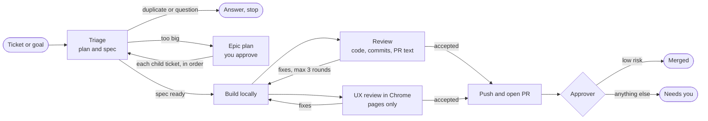

# Software Factory for Claude Code

Give it a ticket or a goal. Get back reviewed, merged work.

Software Factory is a Claude Code plugin. It turns a GitHub issue, a Linear ticket or a goal in words into specified, built, reviewed work, through a team of subagents. You make the decisions that are yours. Low-risk changes merge on their own. Everything else comes to you as a reviewed PR.

```
/software-factory:factory https://github.com/you/repo/issues/42
/software-factory:factory "Build a CRM for a small sales team"
```

## How it works



| Agent | Job |
|---|---|
| **Orchestrator** (`/factory`, your session) | Runs the agents, relays their questions, pushes reviewed work, merges on the approver's word |
| **Triage** | Plans: finds duplicates, breaks big work into child tickets, and writes a verified spec into every ticket |
| **Implementer** | Builds to the spec on a local branch, tests first, and drafts the PR description. Never pushes |
| **Reviewer** | Reviews the local branch before anything is pushed: the code, the commit messages and the PR description |
| **UX reviewer** | Uses any page change in a real browser (Chrome, or headless) and checks what a user sees |
| **Approver** | Decides whether pushed, reviewed work is low risk enough to merge without a person |

Every agent runs on Opus. Planning is where most of the value is.

What the factory promises on every run:

- **No vague tickets reach the builder.** Every ticket gets a spec in its description: behavior, decisions, assumptions, out of scope, and acceptance checks you can run.
- **Big work is broken down.** Anything bigger than one reviewable PR becomes an epic with child tickets. You approve the plan once.
- **Nothing reaches GitHub unreviewed.** Building and review happen locally. Only a commit the reviewer accepted is pushed.
- **Decisions are made once.** They live in the spec and the epic, and later tickets reuse them.
- **You are asked only what is yours to decide.** Everything else is a written assumption you can change.
- **Merging is gated.** The approver merges only small, clean changes that stay out of risky areas: schema, security, input parsing, public interfaces, dependencies, build config and data deletion. Add `--no-merge`, or the `factory:no-merge` label, to always stop before merging.

## Install

**Claude Code:**

```
/plugin marketplace add owainlewis/software-factory
/plugin install software-factory@software-factory
```

Then run `/software-factory:factory <issue, PR or goal>`.

**Codex:**

```bash
codex plugin marketplace add owainlewis/software-factory
codex plugin add software-factory@software-factory
```

Then ask Codex to "run the factory on issue #42". In Codex the factory is a skill, and it spawns one subagent per role.

Requirements:
- The [GitHub CLI](https://cli.github.com) (`gh`), logged in. In Codex, allow network access in the sandbox so `gh` works.
- For UX review: Claude in Chrome (Claude Code), the Chrome DevTools MCP (Codex), or a headless browser such as Playwright. Without one, page changes are never auto-merged.
- For Linear tickets: a Linear MCP server.

## Permissions

The agents run git, `gh` and your test commands many times per run. Without an allowlist you will approve each one. Add something like this to the repo's `.claude/settings.json`, and add your own test and lint commands:

```json
{
  "permissions": {
    "allow": [
      "Bash(git:*)",
      "Bash(gh issue:*)",
      "Bash(gh pr:*)",
      "Bash(gh api:*)",
      "Bash(gh label:*)",
      "Bash(gh auth status:*)",
      "Bash(ls:*)",
      "Bash(cat:*)",
      "Bash(head:*)",
      "Bash(tail:*)",
      "Bash(grep:*)",
      "Bash(wc:*)",
      "Bash(sort:*)",
      "Bash(echo:*)",
      "Bash(sed -n:*)",
      "Bash(date:*)",
      "Bash(mkdir:*)",
      "Bash(printenv:*)"
    ]
  }
}
```

Do not run the factory with all permissions bypassed. Keep `gh repo` and `gh release` out of the list.

## Use

Run it from the root of the repo you want to change:

```
/software-factory:factory #42
/software-factory:factory https://linear.app/acme/issue/ENG-123
/software-factory:factory "Add a --json flag to the export command"
/software-factory:factory https://github.com/you/repo/pull/57
```

A goal in words gets a GitHub issue first, or an epic if it's too big for one PR. A PR URL starts at the review stage. The factory keeps scratch files in `.factory/`, which it ignores in git.

## Labels

The factory creates any of these that are missing, and never changes labels you already have:

| Label | Meaning |
|---|---|
| `factory` | On every issue and PR the factory creates or works on |
| `factory:needs-human` | The approver will not merge this PR without you |
| `factory:no-merge` | Set it on a ticket to stop the factory from merging it |

It also adds your repo's own `bug`, `enhancement` or `documentation` label when one fits. It does not create those.

## Customise

Prompts live in `src/`: `src/orchestrator.md`, `src/roles/*.md`, and a short `src/platform-*.md` for each platform. After editing, run `python3 scripts/build.py` to regenerate `plugin/` for both Claude Code and Codex. `python3 scripts/build.py --check` fails if `plugin/` is out of date.

- **Models**: Claude Code models are set in `src/roles.json`, all Opus by default. Codex subagents use your Codex model with high reasoning effort.
- **Standards**: the quality standard lives in `src/roles/implementer.md`, and the reviewer holds the implementer to it. Your repo's `CLAUDE.md` or `AGENTS.md` always comes first.

## Status

v0.2. Tested on GitHub with local runs in both Claude Code and Codex, each installed from its marketplace. Not yet tested: Linear.

## Evals

`evals/` holds two end-to-end evals with hidden acceptance tests: `tasker` (20 issues on an existing app) and `crm` (a 25-ticket app built from scratch, factory against plain Claude Code). See [evals/README.md](evals/README.md).

## License

MIT
