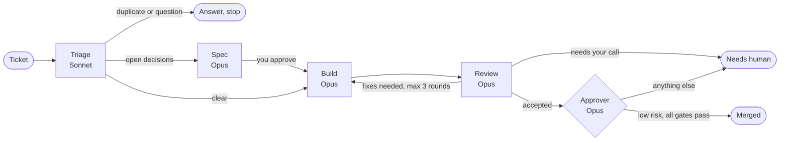

# Software Factory for Claude Code

Give it a ticket. Get back a reviewed pull request.

Software Factory is a Claude Code plugin. It runs a GitHub issue or Linear ticket through a small team of subagents: triage, spec, implement, review, approve. You make the decisions. Low-risk changes merge on their own. Everything else comes to you as a reviewed PR.

```
/software-factory:factory https://github.com/you/repo/issues/42
```

## How it works



| Agent | Job |
|---|---|
| **Orchestrator** (`/factory`, your main session) | Reads the ticket, decides which steps the work needs, runs the agents, relays their questions to you, merges when the approver says so |
| **Triage** | Checks the ticket against the code, reproduces bugs, finds duplicates, sizes the work, writes its findings into the issue |
| **Spec** | Interviews you about open decisions, writes a spec, opens a draft PR for approval |
| **Implementer** | Makes the change, proves it with tests, opens the PR. A fresh one handles each review revision |
| **Reviewer** | Reviews the PR as a skeptic, tries bad input, and reports a verdict. Never posts on GitHub |
| **Approver** | Decides whether an accepted PR is low risk enough to merge without a person |

What makes it work:

- **One standard on both sides.** The implementer and the reviewer carry the same quality standard in their prompts. No skills, nothing loaded on demand: every rule is always in context.
- **A fresh reviewer every round.** It sees the PR as it is, not its earlier opinion. Later rounds review only what changed.
- **Questions go through you.** Agents stop and return questions. The orchestrator asks you, then resumes the same agent with your answers. Small choices become assumptions listed in the PR instead of questions.
- **Gates are conditional.** Trivial changes skip the spec and the review. Clear tickets skip triage. Every skip is recorded.
- **Merging is gated.** The approver merges only when review is clean, checks pass, and the change is small and stays out of risky areas: schema, security, input parsing, public interfaces, dependencies, build config and data deletion. A PR that also closes duplicate issues always goes to a person. Anything else gets the `factory:needs-human` label. Add `--no-merge`, or the `factory:no-merge` label on a ticket, to always stop before merging.

## Install

In Claude Code:

```
/plugin marketplace add owainlewis/software-factory
/plugin install software-factory@software-factory
```

Requirements:
- The [GitHub CLI](https://cli.github.com) (`gh`), logged in.
- For Linear tickets: a Linear MCP server connected to Claude Code.

## Permissions

The agents run git, `gh` and your test commands many times per run. Without an allowlist you will approve each one. Add something like this to the repo's `.claude/settings.json`, and add your own test and lint commands:

```json
{
  "permissions": {
    "allow": [
      "Bash(git:*)",
      "Bash(gh issue:*)",
      "Bash(gh pr:*)",
      "Bash(gh api:*)",
      "Bash(gh label:*)",
      "Bash(gh auth status:*)",
      "Bash(ls:*)",
      "Bash(cat:*)",
      "Bash(head:*)",
      "Bash(tail:*)",
      "Bash(grep:*)",
      "Bash(wc:*)",
      "Bash(sort:*)",
      "Bash(echo:*)",
      "Bash(sed -n:*)",
      "Bash(date:*)",
      "Bash(mkdir:*)",
      "Bash(printenv:*)"
    ]
  }
}
```

Do not run the factory with all permissions bypassed. Keep `gh repo` and `gh release` out of the list.

## Use

Run it from the root of the repo you want to change:

```
/software-factory:factory #42
/software-factory:factory https://linear.app/acme/issue/ENG-123
/software-factory:factory "Add a --json flag to the export command"
/software-factory:factory https://github.com/you/repo/pull/57
```

A plain task gets a GitHub issue first. A PR URL starts at the review stage.

## Run state

Each run writes `.factory/runs/<id>.json` in your repo, with the current stage, the status of each step, and the PR links. The factory writes `.factory/.gitignore` containing `*`, so the folder is never committed. Tools and dashboards can read this file to show progress.

## Labels

The factory creates any of these that are missing, and never changes labels you already have:

| Label | Meaning |
|---|---|
| `factory` | On every issue and PR the factory creates or works on |
| `factory:waiting` | The factory is waiting for you to answer or approve |
| `factory:needs-human` | The approver will not merge this PR without you |
| `factory:no-merge` | Set it on a ticket to stop the factory from merging it |
| `size:S`, `size:M`, `size:L` | The size triage gave the work |

It also adds your repo's own `bug`, `enhancement` or `documentation` label when one fits. It does not create those.

## Run it from GitHub

`examples/github-actions/factory.yml` runs the factory when you add the `factory:run` label to an issue. In CI there is no chat, so the factory posts questions and approval requests as issue comments, adds the `factory:waiting` label, and stops. Your reply on the issue starts the next run.

Copy it to `.github/workflows/factory.yml` and add an `ANTHROPIC_API_KEY` secret.

## Customise

- **Models**: change `model:` in `agents/*.md`. The defaults use Opus for spec, implement and review, and Sonnet for triage.
- **Standards**: edit the "Quality standard" section in `agents/implementer.md` and `agents/reviewer.md`. Keep the two copies the same. Your repo's `CLAUDE.md` or `AGENTS.md` always comes first.

## Status

v0.1, early. The local GitHub flow is the target for this version. Not done yet:

- Triggers for CI failures and stale PRs
- Screenshot or video proof for UI changes
- A live view of runs

## Evals

`evals/tasker/` runs the factory on 20 real issues in a small app and grades each PR with hidden acceptance tests. See [evals/README.md](evals/README.md).

## License

MIT
