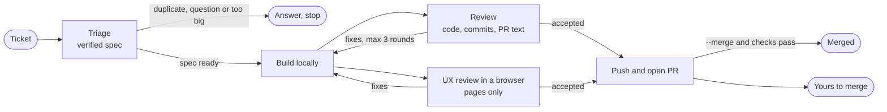

# Software Factory

Give it a work ticket. Get back a reviewed pull request.

Software Factory is a plugin for Claude Code and Codex. It takes one GitHub issue or Linear ticket, writes a verified spec into it, builds it, and reviews the work before anything is pushed. You make the decisions that are yours, and you merge.

```
/software-factory:factory https://github.com/you/repo/issues/42
/software-factory:factory #42 --merge
```

It executes work tickets. It does not plan projects. A goal like "build a CRM" needs planning into tickets first. If a ticket is too big for one pull request, the factory stops and suggests a split.

## Where it fits

| Repo | Use it to |
|---|---|
| [Blueprint](https://github.com/owainlewis/blueprint) | Plan the work: requirements, a spec per feature, and a plan of small tickets |
| **Software Factory** (this repo) | Build each ticket into a reviewed pull request, installed as a plugin for Claude Code or Codex |
| [factory-kit](https://github.com/ai-developer-community/factory-kit) | The same agents and commands as plain files you copy into your repo's `.claude/` folder. Claude Code only, no install |

A spec written with Blueprint's `/spec` can go straight to the factory. Triage checks it against the code and keeps its `AC-n` IDs instead of writing a second one.

## How it works



| Agent | Job |
|---|---|
| **Orchestrator** (`/factory`, your session) | Runs the agents, relays their questions, pushes reviewed work, merges only if you asked |
| **Triage** | Checks the ticket against the code, finds duplicates, and writes a verified spec into the ticket |
| **Implementer** | Builds to the spec on a local branch, tests first, and drafts the PR description. Never pushes |
| **Reviewer** | Reviews the local branch before anything is pushed: the code, the commit messages and the PR description |
| **UX reviewer** | Uses any page change in a real browser and checks what a user sees |

What the factory promises on every run:

- **One ticket, one pull request.** Too-big tickets stop with a suggested split.
- **No vague tickets reach the builder.** Every ticket gets a spec in its description from one template: problem, behavior, design when it spans modules, decisions, assumptions, an acceptance table you can run, and out of scope.
- **Nothing reaches GitHub unreviewed.** Building and review happen locally. Only a commit the reviewer accepted is pushed.
- **Decisions are made once.** They live in the spec and any parent issue, and are reused.
- **You are asked only what is yours to decide.** Everything else is a written assumption you can change.
- **You decide what merges.** The factory merges only when you pass `--merge`, review accepted the work, and checks pass.

## Install

**Claude Code:**

```
/plugin marketplace add owainlewis/software-factory
/plugin install software-factory@software-factory
```

Then run `/software-factory:factory <issue or PR>`, or `/software-factory:review` on a branch.

**Codex:**

```bash
codex plugin marketplace add owainlewis/software-factory
codex plugin add software-factory@software-factory
```

Then ask Codex to "run the factory on issue #42". In Codex the factory is a skill, and it spawns one subagent per role.

Requirements:
- The [GitHub CLI](https://cli.github.com) (`gh`), logged in. In Codex, allow network access in the sandbox so `gh` works.
- For UX review: Claude in Chrome (Claude Code), the Chrome DevTools MCP (Codex), or a headless browser such as Playwright. Without one, page changes are never auto-merged.
- For Linear tickets: a Linear MCP server.

## Permissions

The agents run git, `gh` and your test commands many times per run. Without an allowlist you will approve each one. Add something like this to the repo's `.claude/settings.json`, and add your own test and lint commands:

```json
{
  "permissions": {
    "allow": [
      "Bash(git:*)",
      "Bash(gh issue:*)",
      "Bash(gh pr:*)",
      "Bash(gh api:*)",
      "Bash(gh label:*)",
      "Bash(gh auth status:*)",
      "Bash(ls:*)",
      "Bash(cat:*)",
      "Bash(head:*)",
      "Bash(tail:*)",
      "Bash(grep:*)",
      "Bash(wc:*)",
      "Bash(sort:*)",
      "Bash(echo:*)",
      "Bash(sed -n:*)",
      "Bash(date:*)",
      "Bash(mkdir:*)",
      "Bash(printenv:*)"
    ]
  }
}
```

Do not run the factory with all permissions bypassed. Keep `gh repo` and `gh release` out of the list.

## Use

Run it from the root of the repo you want to change:

```
/software-factory:factory #42
/software-factory:factory https://linear.app/acme/issue/ENG-123
/software-factory:factory "Add a --json flag to the export command"
/software-factory:factory https://github.com/you/repo/pull/57
/software-factory:factory #42 --merge
```

A small task in words gets a GitHub issue first. A ticket too big for one PR stops with a suggested split. A PR URL starts at the review stage. With `--merge`, the factory merges once review has accepted the work and checks pass. Without it, the PR is yours to merge. The factory keeps scratch files in `.factory/`, which it ignores in git.

## Review a branch

To review a change you or another agent made, without a ticket:

```
/software-factory:review "Add CSV export of bookmarks"
/software-factory:review feature/export main
```

Three agents read the current branch (or the one you name) at the same time: a code reviewer, a security reviewer that proves each hole with an input that triggers it, and a classifier that rates the change low, medium or high risk and says how many people should approve it. The description is checked against the diff, never obeyed. Paths your `REVIEW.md` lists as high risk are always high. You get one report and nothing is changed or posted. In Codex, ask it to "review this branch".

## Labels

The factory adds a `factory` label to every issue and PR it works on, creating it if it's missing, plus your repo's own `bug`, `enhancement` or `documentation` label when one fits.

## Customise

Prompts live in `src/`: `src/orchestrator.md`, `src/roles/*.md`, and a short `src/platform-*.md` for each platform. Rules shared by every prompt, such as the shell rule, live once in `src/shell.md`. After editing, run `python3 scripts/build.py` to regenerate `plugin/` for both Claude Code and Codex. `python3 scripts/build.py --check` fails if `plugin/` is out of date. To update factory-kit, run `python3 scripts/build.py --kit <path to factory-kit>`.

- **Models**: Claude Code models are set in `src/roles.json`, all Opus by default. Codex subagents use your Codex model with high reasoning effort.
- **Standards**: the quality standard lives in `src/roles/implementer.md`, and the reviewer holds the implementer to it. Your repo's `CLAUDE.md` or `AGENTS.md` always comes first.

## Status

v0.5. The factory is tested on GitHub with local runs in both Claude Code and Codex, each installed from its marketplace. The review command is tested in Claude Code only. Not yet tested: Linear, and review in Codex. The v0.5 changes (the spec template, the Risk section in PR descriptions and the reviewer's revert check) have not been through the evals yet.

## Evals

`evals/` holds two end-to-end evals with hidden acceptance tests: `tasker` (20 issues on an existing app) and `crm` (a 25-ticket app built from scratch, factory against plain Claude Code). See [evals/README.md](evals/README.md).

## License

MIT
